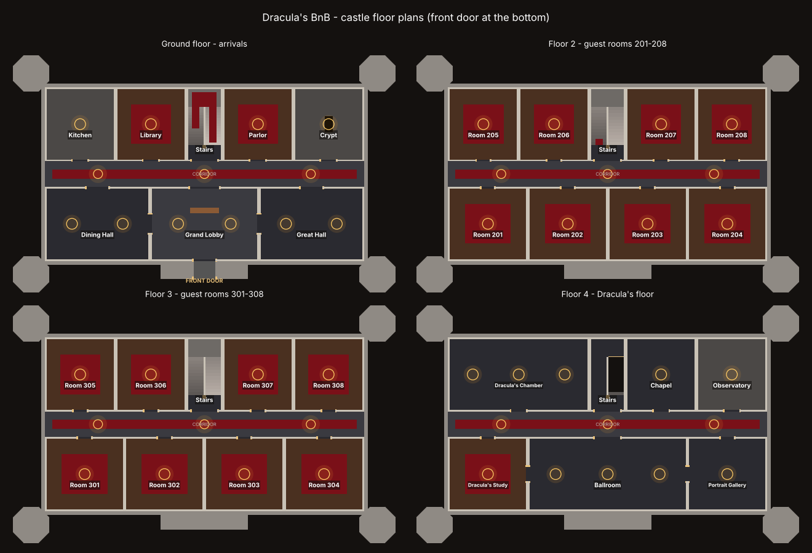

# Anomaly Mansion

A Roblox game: Dracula's mansion is now a bed and breakfast. Host guests by day, spot anomalies by night.

## Workflow

Scripts are written in Roblox Studio's built-in editor. This repo keeps a copy of each
script so it's backed up and versioned. To use one, create a Script in Studio at the
location below and paste the file's contents in.

| File | Studio location | Type |
|---|---|---|
| `src/server/GameManager.server.lua` | ServerScriptService/GameManager | Script |
| `src/client/ClockHUD.client.lua` | StarterPlayer/StarterPlayerScripts/ClockHUD | LocalScript |
| `src/client/CandleFlicker.client.lua` | StarterPlayer/StarterPlayerScripts/CandleFlicker | LocalScript (the Castle Builder creates this for you) |

## Building the castle

`tools/CastleBuilder.lua` builds Dracula's whole castle: 4 floors, 29 rooms (16 of them
guest rooms), corridors, a stone switch-back staircase, candles, towers, battlements and
the entrance gatehouse. It isn't a game script. Run it once in Studio:

1. Stop Play mode.
2. Open **Window > Command Bar**, paste the whole file in and click **Run**.
3. The castle appears as `Workspace/DraculaCastle`. Running it again rebuilds it from
   scratch, so change the settings at the top of the file and re-run any time.

Texture IDs, floor heights and candle spacing are at the top of the file. Every room is a
Model with `RoomName`, `RoomKind`, `Floor` and (for guest rooms) `RoomNumber` attributes,
plus an invisible `Zone` part, so game scripts can tell which room someone is in.

`default.project.json` is an optional [Rojo](https://rojo.space) config for syncing these
files into Studio automatically later. It isn't needed for the copy/paste workflow.
